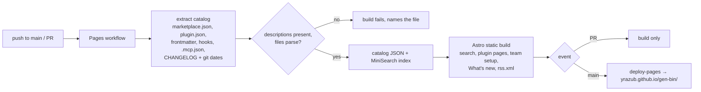

# Spec: gen-bin catalog site
Spec ID: SPEC-2026-10-22-catalog-site
Status: implemented (2026-10-22; approved with open questions resolved as recommended, amended the same day with the theme switcher and the local run, AC-40–AC-47, and with the deploy action in the decision table)
Design: [`docs/design/catalog-site.md`](../design/catalog-site.md)
Supersedes: —

## Problem and user

**Users.** Developers who use Claude Code and are deciding whether to add the gen-bin marketplace,
or which of its plugins to install. They usually arrive with a task in mind ("I need a skill for
reviewing Fastify routes") rather than a plugin name.

**Today.** The only way to find out what gen-bin offers is the GitHub repository: open each
`plugins/<name>/` folder, read `plugin.json`, then open every `SKILL.md` and agent file by hand.
`/plugin` inside Claude Code lists plugins by name and one-line description only, and only after
the marketplace has been added. The user can't search by task, can't see which skill or agent
inside a plugin matches it, and can't see what code a plugin will run on their machine before
installing it. Since auto-update is off by default for third-party marketplaces, there is also
nowhere to find out that a new version is out.

**After.** A static site on GitHub Pages:
- a keyword search over every plugin, skill, agent, command, hook and MCP server in the
  repository, with results shown as cards that carry the install command;
- a page per plugin that shows its contents and everything it runs;
- a generator that turns a set of chosen plugins into a team settings snippet;
- a "What's new" page with an RSS feed.

The site is built from the same files Claude Code reads, so it can't drift from the marketplace.

## Goals / Non-goals

**Goals**
- Find any artifact in the repository by English keywords, and show the matches as cards.
- Give every plugin a page with:
  - its README;
  - its inventory (the skills, agents, commands, hooks and MCP servers in it);
  - its install commands;
  - its dependencies;
  - its release notes.
- Show, per plugin, everything it executes or connects to, before anyone installs it.
- Generate a ready-to-commit `.claude/settings.json` snippet for a chosen set of plugins.
- Publish release notes as a page and an RSS feed.
- Rebuild and redeploy automatically on every change to `main`, with no server and no secrets.
- Let the user choose a light, dark or system theme, and remember the choice.
- Run the whole site on the maintainer's machine with one command. Pages hosts the same build at
  `https://yrazub.github.io/gen-bin/`.

**Non-goals**
- **Non-English queries, synonym dictionaries, semantic or embedding search.** The user chose
  English-only keyword search. The search index format must not rule these out later.
- **Install counts, ratings, user accounts, saved lists, comments.** These need a backend or
  telemetry that Claude Code doesn't provide. Comments through giscus were proposed for later.
- **"Ask Claude" on the site.** An API key in a static page would be public.
- **Recommendations from a pasted `package.json`, the SDD workflow diagram, "Request a skill"
  issue links, `llms.txt` and a machine-readable catalog, version badges.** These were proposed and
  deferred past the MVP.
- **Rendering LSP servers, output styles, themes, monitors or workflows as their own card types.**
  The planned plugins don't use them. They are counted in a plugin's inventory if present (AC-17).
- **Content of plugins whose marketplace `source` is not a relative path.** Their files are not in
  this repository. Such a plugin is shown from its catalog entry only (EC-6).
- **Custom domain.** The site lives at the default Pages URL.

## User stories

- US-1: As a developer with a task, I want to type a few English keywords and see every matching
  plugin, skill and agent as a card, so that I find the right artifact without knowing its name.
- US-2: As a developer who found a card, I want to copy the command that installs it and see how to
  invoke it, so that I can start using it in one step.
- US-3: As a developer evaluating a plugin, I want one page that shows everything in it and its
  README, so that I can judge it without browsing the repository.
- US-4: As a developer about to install a plugin, I want to see which hooks, MCP servers,
  executables and agent tools it brings, so that I know what will run on my machine.
- US-5: As a team lead, I want to pick several plugins and get a settings snippet for our
  repository, so that every teammate gets the same plugins without manual steps.
- US-6: As an existing user, I want to see what changed in each release and subscribe to it, so
  that I know when to update.
- US-7: As the maintainer, I want the site rebuilt and published on every merge to `main`, and a
  failed build when an artifact has no description, so that the catalog is always current and
  never shows an empty card.
- US-8: As someone sharing a find, I want the search and the plugin selection kept in the URL, so
  that the link I send opens the same view.
- US-9: As a reader, I want to switch between light and dark themes or follow my system, so that
  the site is comfortable to read in my environment.
- US-10: As the maintainer, I want to build and browse the site locally exactly as Pages will serve
  it, so that I can check a change before it is pushed.

## Acceptance criteria (EARS)

Terms used below:
- **Artifact:** a plugin, or a skill, agent, command, hook or MCP server inside a plugin.
- **Install command:** `/plugin install <plugin>@gen-bin`.
- **Search page:** the site's home page.

| ID | Priority | Requirement | Story | Verify by |
|---|---|---|---|---|
| AC-1 | P1 | The search index shall contain one entry for every plugin listed in `marketplace.json` and for every skill, agent, command, hook and MCP server inside a plugin whose source is a relative path. | US-1 | unit (site) |
| AC-2 | P1 | WHEN the user types a query of at least 2 characters into the search box, the search page shall show the matching artifacts as cards, best match first, within 300 ms of the last keystroke. | US-1 | e2e (site) |
| AC-3 | P1 | The search page shall match a query word against an artifact's name, description, tags, parent plugin name and body text, case-insensitively, including prefix matches (`fasti` finds `fastify`) and one-typo matches for words of 5 or more letters. | US-1 | unit (site) |
| AC-4 | P1 | The search page shall rank a match in an artifact's name above a match in its description, and a match in its description above a match in its body text. | US-1 | unit (site) |
| AC-5 | P1 | Each card shall show the artifact's type, its invocable name (`/<plugin>:<skill>`, `@agent-<plugin>:<agent>`, `<plugin>` for a plugin), its parent plugin, its description, the parent plugin's version and a link to the artifact's source file on GitHub. | US-1, US-2 | e2e (site) |
| AC-6 | P1 | Each card shall have a copy button that copies the parent plugin's install command to the clipboard and then shows "Copied" for 2 s. | US-2 | e2e (site) |
| AC-7 | P2 | Each card shall highlight the query words found in its name and description. | US-1 | e2e (site) |
| AC-8 | P2 | The search page shall offer a type filter with the options All, Plugins, Skills, Agents, Commands, Hooks and MCP servers. | US-1 | e2e (site) |
| AC-9 | P1 | WHILE the search box is empty, the search page shall show one card per plugin, in catalog order. | US-1 | e2e (site) |
| AC-10 | P1 | IF a query matches no artifact, THEN the search page shall show "No matches for "<query>"" and a control that clears the query and the type filter. | US-1 | e2e (site) |
| AC-11 | P2 | WHEN the query or the type filter changes, the search page shall replace its URL query with `?q=<query>&type=<type>`. | US-8 | e2e (site) |
| AC-12 | P1 | The site shall have one page per plugin, reachable from that plugin's card and from the card of every artifact inside it. | US-3 | build (site) |
| AC-13 | P1 | The plugin page shall show the plugin's display name, description, version, author, license and its README rendered from Markdown. | US-3 | build (site) |
| AC-14 | P1 | The plugin page shall list every skill, agent, command, hook and MCP server of the plugin, each with its invocable name and description. | US-3 | build (site) |
| AC-15 | P1 | The plugin page shall show the install command for a Claude Code session, the same step for a shell (`claude plugin install <plugin>@gen-bin`), and the one-time marketplace command (`/plugin marketplace add yrazub/gen-bin`), each with a copy button. | US-2, US-3 | e2e (site) |
| AC-16 | P2 | WHERE a plugin declares `dependencies`, the plugin page shall list each dependency, linking the ones that are plugins of gen-bin to their pages. | US-3 | build (site) |
| AC-17 | P1 | The plugin page shall have a "What this plugin runs" panel that lists every hook (event, matcher, command text), every MCP server (name and its command or URL), the files in a top-level `bin/` directory, and for each agent its `tools` and `model`. | US-4 | build (site) |
| AC-18 | P1 | IF a plugin has no hooks, MCP servers or `bin/` files, THEN the "What this plugin runs" panel shall say "This plugin runs no hooks, MCP servers or executables." and still list its agents' tools. | US-4 | build (site) |
| AC-19 | P2 | The plugin page shall show the plugin's release notes from `CHANGELOG.md`, newest first. | US-6 | build (site) |
| AC-20 | P1 | Every plugin card and plugin page shall have an "Add to team setup" toggle. | US-5 | e2e (site) |
| AC-21 | P1 | The team setup page shall show a JSON snippet for `.claude/settings.json` that registers the marketplace under `extraKnownMarketplaces` (source `github`, repo `yrazub/gen-bin`) and sets `"<plugin>@gen-bin": true` under `enabledPlugins` for each selected plugin, with a copy button. | US-5 | unit (site) |
| AC-22 | P2 | WHEN a selected plugin depends on another gen-bin plugin, the team setup page shall include that plugin in the snippet, labelled "added as a dependency of <plugin>". | US-5 | unit (site) |
| AC-23 | P2 | WHEN the selection changes, the team setup page shall replace its URL query with `?plugins=<a>,<b>`. | US-5, US-8 | e2e (site) |
| AC-24 | P1 | IF no plugin is selected, THEN the team setup page shall say "No plugins selected" and link to the search page. | US-5 | e2e (site) |
| AC-25 | P1 | The "What's new" page shall list every release entry in `CHANGELOG.md`, newest first, each with plugin name, version, release date and its notes rendered from Markdown. | US-6 | build (site) |
| AC-26 | P1 | The site shall publish an RSS feed with one item per release entry, carrying the title `<plugin> <version>`, the release date and a link to the plugin page. | US-6 | build (site) |
| AC-27 | P1 | WHEN a commit lands on `main`, the Pages workflow shall build the site and deploy it to `https://yrazub.github.io/gen-bin/`. | US-7 | manual |
| AC-28 | P1 | WHEN a pull request is opened or updated, the Pages workflow shall build the site without deploying it. | US-7 | manual |
| AC-29 | P1 | IF a skill, agent or command has no `description` in its frontmatter, or a plugin has none in its catalog entry or `plugin.json`, THEN the site build shall fail with a message naming the file. | US-7 | unit (site) |
| AC-30 | P1 | WHILE `marketplace.json` lists no plugins, the search page shall show "No plugins published yet" (the build itself succeeds, see EC-1). | US-7 | build (site) |
| AC-31 | P1 | Every link and asset URL on the site shall resolve under the `/gen-bin/` path prefix. | US-7 | build (site) |
| AC-32 | P2 | WHILE JavaScript is disabled, the plugin pages and the "What's new" page shall show their full content. | US-3, US-6 | e2e (site) |
| AC-33 | P3 | The marketplace `README.md` shall link to the catalog site. | US-1 | manual |
| AC-34 | P2 | WHEN a type other than All is selected in the type filter, the search page shall show only cards of that type. | US-1 | e2e (site) |
| AC-35 | P2 | WHEN the search page is opened with `q` or `type` URL parameters, the search page shall show the search they describe. | US-8 | e2e (site) |
| AC-36 | P1 | The site header shall show a "Team setup" link with the number of plugins selected in this browser. | US-5 | e2e (site) |
| AC-37 | P2 | WHEN the team setup page is opened with a `plugins` URL parameter, the team setup page shall show that selection. | US-5, US-8 | e2e (site) |
| AC-38 | P2 | Every page shall link the RSS feed in its `<head>` for feed autodiscovery. | US-6 | build (site) |
| AC-39 | P2 | WHILE JavaScript is disabled, the search page shall show one card per plugin and a notice that search needs JavaScript. | US-1 | e2e (site) |
| AC-40 | P1 | The site header shall have a theme control with the options System, Light and Dark, with System selected by default. | US-9 | e2e (site) |
| AC-41 | P1 | WHILE System is selected or JavaScript is disabled, the site shall use the operating system color scheme. | US-9 | e2e (site) |
| AC-42 | P1 | WHEN the user picks a theme, the site shall apply it to the current page at once and to every page they open later in the same browser. | US-9 | e2e (site) |
| AC-43 | P2 | WHEN a page loads with a stored Light or Dark choice, the page shall render in that theme from its first paint, without showing the other theme first. | US-9 | e2e (site) |
| AC-44 | P1 | WHEN the maintainer runs `npm run dev` in `site/`, the site shall be served at `http://localhost:4321/gen-bin/` from the local working tree, and pick up edits to plugin files on reload. | US-10 | manual |
| AC-45 | P1 | WHEN the maintainer runs `npm run build` and then `npm run preview` in `site/`, the preview shall serve at `http://localhost:4321/gen-bin/` the same files the Pages workflow deploys for that commit. | US-10 | manual |
| AC-46 | P1 | Once `npm ci` has run, the site build shall complete with network access disabled and without any GitHub credentials. | US-10 | build (site) |
| AC-47 | P2 | The `site/README.md` shall list the commands to install, develop, test, build and preview the site, and the Node.js version they need. | US-10 | manual |

## Edge cases

| ID | Case | Expected behaviour | Covered by |
|---|---|---|---|
| EC-1 | The marketplace has no plugins (today's state) | The build succeeds. Search shows "No plugins published yet"; team setup and "What's new" show their empty states. | AC-30, AC-24 |
| EC-2 | A plugin has no `plugin.json` | Its catalog entry serves as its manifest (as in Claude Code); name, description and version come from the entry. | AC-1, AC-13 |
| EC-3 | A plugin has no README | The plugin page omits the README section and shows the rest. | AC-13 (accepted: no placeholder) |
| EC-4 | A plugin has no `version` | Cards and the plugin page show "unversioned". Release notes, if any, still show. | AC-5, AC-13 |
| EC-5 | Two plugins each have a skill or agent with the same name | Both are indexed. They differ by their invocable names (`/a:review`, `/b:review`), and each card shows its own parent plugin. | AC-5 |
| EC-6 | A catalog entry's `source` is `github`, `url`, `git-subdir`, `npm`, `archive` or `command` | Only the plugin is indexed, from its catalog entry fields. Its page says "Contents are hosted outside this repository" and links to the source. The "What this plugin runs" panel says it can't be inspected here. | Non-goal, AC-18 (wording differs; see OQ-4) |
| EC-7 | A description is longer than 200 characters | The card shows the first 200 characters and an ellipsis; the plugin page shows it in full. | AC-5 |
| EC-8 | A README uses relative links or images (`./docs/x.md`, `./img.png`) | Links resolve to the file on GitHub at the built commit; images resolve to the raw file at that commit. | AC-13 |
| EC-9 | A query contains HTML or Markdown characters (`<script>`, `*`, `"`) | They are matched and shown as literal text, never interpreted. | Untrusted inputs |
| EC-10 | A `CHANGELOG.md` entry names a plugin no longer in the catalog (removed or renamed) | The entry stays on "What's new" and in the feed, without a link to a plugin page. | AC-25, AC-26 |
| EC-11 | `?plugins=` in the team setup URL names a plugin that doesn't exist | That name is ignored and listed as "Unknown plugin: <name>". | AC-23 |
| EC-12 | The clipboard API is unavailable (insecure context, denied permission) | The copy button selects the command text so the user can copy it by hand, and shows "Press Ctrl/Cmd+C". | AC-6 |
| EC-13 | Malformed frontmatter or invalid JSON in a plugin file | The build fails, naming the file and the parse error. | AC-29 |
| EC-14 | GitHub Pages is not enabled for the repository, or its source isn't "GitHub Actions" | The deploy job fails. This is a one-time repository setting, outside the build. | OQ-3 |
| EC-15 | Browser storage is unavailable (private mode, blocked site data) | The team selection and the theme choice last only while the page is open. The `?plugins=` URL still carries the selection to the team setup page, and nothing errors. | AC-36, AC-37, AC-42 |
| EC-16 | Locally, a `CHANGELOG.md` entry is not committed yet, so git has no date for it | The entry shows "Unreleased" in place of a date, on the page and in the feed. | AC-25, AC-44 |
| EC-17 | The local clone is shallow, or the site is built outside a git checkout | The build still succeeds. Release dates it can't resolve show "Unreleased", and the build prints a warning naming them. | AC-46 |
| EC-18 | The stored theme value is anything other than `system`, `light` or `dark` | It is ignored and System is used. | AC-40 |

## Non-functional requirements

- **NFR-1, search page weight:** at most 60 KB of JavaScript (gzip) to load the search page, not
  counting the search index. The plugin and "What's new" pages ship no JavaScript other than the
  copy and team-setup controls.
- **NFR-2, index size:** the search index is at most 500 KB gzip for up to 300 artifacts. Body text
  is capped at the first 2,000 characters per artifact.
- **NFR-3, search latency:** at most 50 ms per query on 300 artifacts on a mid-range laptop,
  measured from input to rendered cards, excluding the 150 ms input debounce.
- **NFR-4, accessibility:**
  - every control is reachable and operable by keyboard, and has an accessible name;
  - the result count is announced through a live region;
  - colour contrast meets WCAG 2.2 AA;
  - layout works from 320 px wide without horizontal scrolling.
- **NFR-5, clone size:** users' `marketplace add` clones the whole repository, so:
  - the site's source is the only addition to the repository;
  - build output is never committed;
  - there is no `gh-pages` branch;
  - no committed binary file is larger than 100 KB.
- **NFR-6, no runtime dependencies:** the deployed site calls no API and no third-party origin at
  runtime. Everything it shows is computed at build time from the repository.
- **NFR-7, build time:** the Pages workflow finishes in under 5 minutes.
- **NFR-8, browsers:** the latest two versions of Chrome, Firefox, Safari and Edge.
- **NFR-9, local run:**
  - the only requirement is Node.js 22 or later with npm: no Docker, no global packages, no
    environment variables;
  - the dev server, the preview and the deployed site share one `base` (`/gen-bin/`), so a link that
    works locally works on Pages;
  - a fresh clone is running in under 2 minutes with `npm ci && npm run dev`.

## Inputs and provenance

**Sources of this spec**
- The feature request in conversation on 2026-10-22, and the proposal the user answered:
  - search language: English only;
  - MVP: search + plugin page + "What this plugin runs" + team setup generator + "What's new";
  - stack: Astro for the build, vanilla JavaScript in the browser;
  - spec location: `docs/specs/` in gen-bin.
- Claude Code plugin docs, read on 2026-10-21:
  - [marketplace reference](https://code.claude.com/docs/en/plugins/marketplace-reference);
  - [manifest reference](https://code.claude.com/docs/en/plugins-reference);
  - [plugin components](https://code.claude.com/docs/en/plugins/components).
- Base commit `58fa73f` (gen-bin `main`, empty marketplace scaffold).

**Decisions taken in discovery**

| Decision | Choice | Reason |
|---|---|---|
| Build tool | Astro 7, static output, `base: '/gen-bin/'` | Generates a page per plugin, renders Markdown, escapes output by default and builds RSS with `@astrojs/rss`. Without it, a hand-written generator would be needed. |
| Browser code | Vanilla JS in Astro `<script>` islands, no UI framework | The interactive parts are small: the search box, copy buttons, team selection. |
| Search engine | MiniSearch, index built at build time and loaded as JSON | Prefix and fuzzy matching, per-field boosts, a serialisable index, ~7 KB gzip. |
| Deploy | `actions/upload-pages-artifact` + `actions/deploy-pages`, pinned by SHA | No `gh-pages` branch, so the marketplace clone doesn't grow (NFR-5). One job also runs the tests and builds pull requests without uploading; `withastro/action` uploads on every run. |
| Themes | Colour tokens as CSS custom properties for light and dark. A `data-theme` attribute on `<html>` overrides `prefers-color-scheme`, and a small inline script in `<head>` sets it from storage before first paint. | Keeps CSS working without JavaScript (AC-41) and avoids a flash of the wrong theme (AC-43). |
| Local run | `npm run dev` (Astro dev server), `npm run build` + `npm run preview` (the exact deploy output), all served under `/gen-bin/` | One `base` for local and Pages, so links never differ between the two (NFR-9). |

**Data flow**

| Data | Produced by | Contract | Consumed by | When unavailable |
|---|---|---|---|---|
| Plugin list | `.claude-plugin/marketplace.json` | Claude Code marketplace schema | build: catalog extraction | build fails (EC-13) |
| Plugin metadata | `plugins/<name>/.claude-plugin/plugin.json` | Claude Code manifest schema | build: catalog extraction | catalog entry used (EC-2) |
| Skills, agents, commands | `SKILL.md`, `agents/**/*.md`, `commands/*.md` frontmatter and body | `name`, `description`, `tools`, `model` fields | build: catalog extraction, search index | missing description fails the build (AC-29) |
| Hooks, MCP servers, executables | `hooks/hooks.json`, `.mcp.json`, `plugin.json` `hooks`/`mcpServers`, `bin/` | Claude Code hooks and MCP config shapes | build: "What this plugin runs" | panel says none (AC-18) |
| Release notes | `CHANGELOG.md` `## <plugin> <version>` sections | heading convention enforced by the catalog guard | build: plugin page, "What's new", RSS | empty states |
| Release date | git history (the commit that added the heading) | — | build: "What's new", RSS | see OQ-1 |
| Catalog + search index | build | site-internal JSON | search page, team setup page | — |

## Ownership

| Part | Location | Module spec |
|---|---|---|
| Catalog extraction, search index, all pages, RSS, theme control | `site/` (new Astro project, own `package.json` and npm lockfile; scripts `dev`, `build`, `preview`, `test`) | None. gen-bin has one buildable module, and this spec carries its detail. |
| Build and deploy | `.github/workflows/pages.yml` (new) | — |
| README link | `README.md` | — |

Test suites this spec introduces, because gen-bin has none:
- `unit (site)`: vitest over the catalog extraction, the search ranking and the snippet generator,
  run against fixture marketplaces;
- `build (site)`: assertions over the built `dist/` output;
- `e2e (site)`: browser tests against the built site served locally;
- `manual`: checks that need GitHub itself.

## Untrusted inputs

Plugin content can come from pull requests by people other than the maintainer.

| Input | Origin | Reaches | Handling |
|---|---|---|---|
| README, CHANGELOG, `SKILL.md` and agent bodies (Markdown) | repository files | plugin page, "What's new", RSS, search index | Rendered from Markdown with raw HTML disabled. Only `http`, `https` and `mailto` link URLs are kept; any other scheme (`javascript:`, `data:`) is dropped. RSS content is escaped. |
| Frontmatter and JSON fields (name, description, tags, author, URLs) | repository files | cards, plugin page, team setup snippet | Inserted as text, never as HTML. `homepage`/`repository` are linked only if they parse as `http(s)` URLs. Inside the JSON snippet, values are JSON-encoded. |
| Hook commands, MCP server commands and URLs | repository files | "What this plugin runs" panel | Shown as text in code blocks, never linked or executed. |
| `?q=`, `?type=` and `?plugins=` URL parameters | any link | search page, team setup page | Shown as text only. Highlighting escapes before marking. `type` must be one of the known values (anything else is ignored). `plugins` entries are matched against the catalog (EC-11). |
| Stored theme and team selection | browser storage, which other scripts on the origin can write | theme control, team setup page | The theme must be one of `system`, `light`, `dark` (EC-18). Selection entries are matched against the catalog like `?plugins=`. |

## Open questions

| ID | Question | Recommended answer | Blocks |
|---|---|---|---|
| OQ-1 | Where does a release's date come from? | The date of the commit that added its `CHANGELOG.md` heading (`git log`, with full history in CI). The heading convention and the catalog guard stay unchanged. | AC-25, AC-26 |
| OQ-2 | Should skill and agent body text be searchable, or only names, descriptions and tags? | Searchable, with the lowest weight and capped at 2,000 characters (NFR-2). "Search through all the content" was part of the request. | AC-3 |
| OQ-3 | Enabling Pages: someone has to set Settings → Pages → Source to "GitHub Actions" once. | The maintainer does it before the first deploy. The implementation plan lists it as a manual step. | AC-27 |
| OQ-4 | For a plugin with an external source (EC-6), should the build fetch its repository to index its contents? | No for the MVP: index the catalog entry only and say so on the page. Fetching would make the build depend on third-party repositories. | approval |
| OQ-5 | Should the site be built and tested while the marketplace is still empty? | Yes. Develop against fixture marketplaces in `site/` tests, and deploy the empty-state site. Real content arrives with the migration plan. | — |
