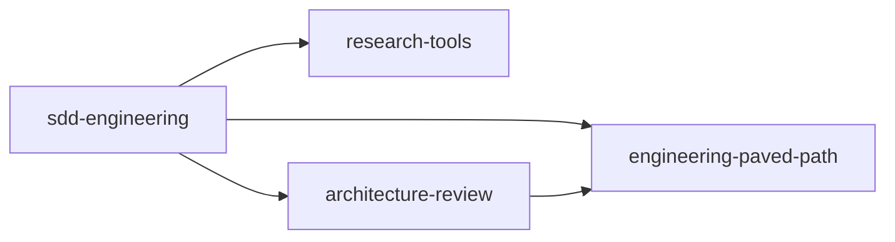

# sdd-engineering

A spec-driven development chain for Claude Code: **spec → plan → implement → review → verify →
document**, driven by six agents and a resumable `run-plan` skill, plus a retrospective skill.

## Install

```bash
claude plugin marketplace add yrazub/gen-bin
claude plugin install sdd-engineering@gen-bin
```

Installing it also installs three dependencies (`^1.0.0`, resolved against the git tags
`<plugin>--v<version>` of this repository):



If you disable a dependency, `sdd-engineering` stays disabled and reports it. Re-enable the
dependency (`/plugin`, or `claude plugin enable <name>`) and then `sdd-engineering`.

## The chain

Everything is namespaced by plugin: `sdd-engineering:implementer`, `research-tools:researcher`,
`/sdd-engineering:run-plan`. Agents cannot see each other's output; the main session (or
`run-plan`) carries every handover.

| Step | Agent | Takes | Hands over | Paved-path skills it uses |
|---|---|---|---|---|
| 1. Specify | `sdd-engineering:spec-creator` (discovery pass, then write pass) | a feature request, designs | questions for you, then a spec with EARS acceptance criteria in a `specs/` folder | `mermaid-diagram`, `security` |
| 2. Plan | `sdd-engineering:implementation-planner` (review pass, plan pass, amend pass) | an approved spec | clarifications and the execution mode, then an Implementation Plan with phases, file tables, skills, Verify lines | the architecture skills, named in the plan |
| 3. Build | `sdd-engineering:implementer`, one phase at a time | the plan and a phase | code, an Implementation report | the skills the phase names (`react-best-practices`, `fastify-best-practices`, `zod`, …) |
| 4. Test | `sdd-engineering:test-writer` | the phase and the implementer's list of failing tests | tests, a Test report | `react-testing-library` and the skills the phase names |
| 5. Review | `architecture-review:architecture-reviewer` | changed files and a patch | findings with rule, file, line and quoted code | `onion-architecture`, `frontend-ui-architecture` |
| 6. Verify | `sdd-engineering:plan-verifier` | the plan | one row per plan item with status and evidence | — |
| 7. Document | `sdd-engineering:doc-writer` | the plan and the changed files | updated documentation | `mermaid-diagram` |
| any time | `research-tools:researcher` | a question | a report with evidence and what could not be found | — |

`/sdd-engineering:run-plan <plan>` runs steps 3–7 for you, phase by phase, in the mode the plan
states (multi-agent, or single-agent where the main session builds). Progress lives in a state
file, so a new chat resumes where the last one stopped; it asks for a new chat every three
committed phases. It never pushes.

`/sdd-engineering:workflow-retro` looks back at a finished multi-agent run: metrics, what was hard,
and concrete recommendations. It appends one row to a trend log.

## Folders the workflow reads and writes

Defaults in a repository that says nothing else (the task or the project can name others; for the
state directory set `SDD_STATE_DIR`):

| What | Default |
|---|---|
| specs | `docs/specs/` (a package-level spec may sit in `<package>/specs/`) |
| plans | `docs/plans/<feature>.md` |
| run state, phase slices, patches | `.sdd/<feature>/` — add it to `.gitignore` |
| retro trend log | `docs/retros/ledger.md` (`ledger:<path>` overrides) |

If the project has no spec folder, `spec-creator` asks which one to use rather than creating one.
Agents also read the project's own `CLAUDE.md` files; they win over the skills.

## The hook

`hooks/hooks.json` registers a `PreToolUse` hook on `Write|Edit`. It acts only when the call comes
from `spec-creator`, and then allows Markdown files under a directory named `specs` and nothing
else — never a `plans` folder, never code. For the main session and every other agent it exits at
once and blocks nothing.

## Not included

- **No push gate and no self-review skill.** DevDigest's `pr-self-review` is project-specific. The
  last steps of `run-plan` run your own review if you have one, and are marked skipped otherwise.
  It never pushes; pushing is yours.
- **No insights skill.** The step that records findings in a notes file runs only if the project
  has one.
- **No database skills** and no project folders such as `server/` or `client/`; the plan names the
  folders.

## If you already have an agent with the same name

A project `.claude/agents/implementer.md` coexists with `sdd-engineering:implementer`. `run-plan`
and the other components always call the namespaced one.

## Release notes

See [CHANGELOG.md](../../CHANGELOG.md).
